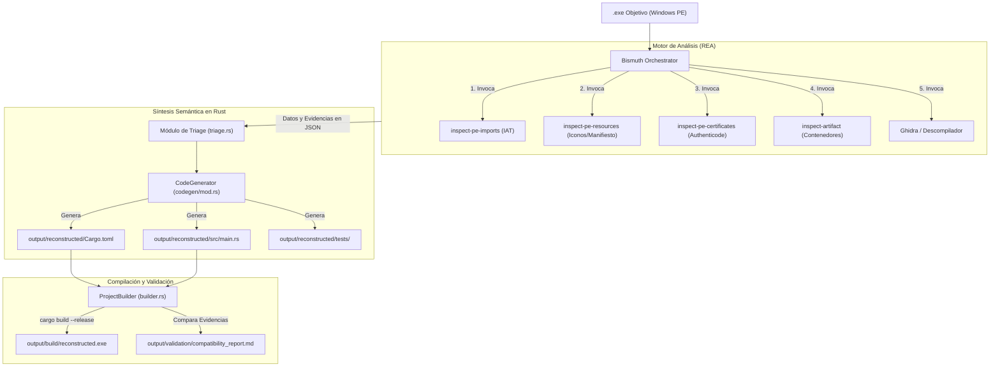

<div align="center">

# ⚗️ Bismuth

### Motor de Modernización y Reconstrucción Automatizada de Binarios Windows en Rust mediante REA

[](https://www.rust-lang.org/)
[-blue?style=flat-square)](https://github.com/morluto/rea)
[-0078d4?style=flat-square&logo=windows)](https://microsoft.com)
[-green?style=flat-square)](LICENSE.md)

<p align="center">
  <b>Transforma ejecutables heredados de Windows en proyectos modernos, modulares y compilables en Rust seguro, utilizando evidencias técnicas verificables.</b>
</p>

</div>

---

## 📖 Descripción General

**Bismuth** es un orquestador y sintetizador semántico escrito en Rust que automatiza la ingeniería inversa limpia y modernización de ejecutables `.exe` de Windows. 

Utiliza **REA (Reverse Engineer Anything)** como su motor de análisis estático e inspección de evidencias (IAT, EAT, tablas de recursos, certificados Authenticode y descompilación con Ghidra), y se encarga de:
1. **Analizar y clasificar el binario** (Nativo C/C++, .NET, empaquetadores como *install4j*, Electron o PyInstaller).
2. **Organizar las evidencias** en carpetas estructuradas de trabajo (`output/analysis`, `output/extracted`).
3. **Generar automáticamente un proyecto Cargo independiente en Rust**, traduciendo las APIs de Windows detectadas a los crates oficiales modernos (`windows-rs`).
4. **Compilar el proyecto resultante** (`cargo build --release`) para generar un nuevo ejecutable limpio (`reconstructed.exe`).
5. **Validar la compatibilidad y emitir un informe de cobertura** (`compatibility_report.md`).

---

## 🏗️ Arquitectura del Sistema



---

## 📂 Estructura de Salida (`output/`)

Cada ejecución de Bismuth produce un espacio de trabajo ordenado y auditable:

```text
output/
  ├── analysis/
  │   ├── executable_info.json    <-- Diagnóstico de arquitectura, tecnología y subsistema
  │   ├── dependencies.json       <-- DLLs y funciones Win32 importadas en la IAT
  │   ├── resources_tree.json     <-- Árbol de recursos (iconos, diálogos, manifiestos)
  │   ├── certificates.json       <-- Firmas y certificados Authenticode
  │   └── pseudocode/             <-- Código descompilado extraído
  ├── extracted/
  │   ├── resources/              <-- Archivos binarios de recursos extraídos
  │   └── metadata/
  │       └── package_inventory.json <-- Inventario de contenedores (si aplica)
  ├── reconstructed/              <-- Proyecto Cargo completamente autónomo
  │   ├── Cargo.toml
  │   ├── src/
  │   │   ├── main.rs             <-- Código fuente en Rust seguro
  │   │   └── modules/
  │   └── tests/
  │       └── smoke_test.rs
  ├── build/
  │   └── reconstructed.exe       <-- Nuevo binario compilado por Bismuth
  └── validation/
      └── compatibility_report.md <-- Informe de fidelidad y limitaciones
```

---

## 🚀 Requisitos Previos

1. **Rust (Edición 2024 o 2021 / Cargo):**
   - Requiere Rust instalado con soporte para Windows MSVC (`rustup toolchain install stable`).
   - C++ Build Tools de Visual Studio (enlazador `link.exe` y Windows SDK).
2. **Node.js (v22+ o superior):**
   - Necesario para ejecutar el motor de REA (`npx rea-agents@latest`).
3. **Ghidra (Opcional para descompilación nativa profunda):**
   - Configurado en el entorno si se requiere análisis profundo de procedimientos nativos.

---

## 💻 Uso de la CLI

### 1. Compilar Bismuth
```powershell
cargo build --release
```

### 2. Flujo Completo (Análisis + Reconstrucción + Compilación)
Ejecuta todo el ciclo de principio a fin sobre un ejecutable objetivo:
```powershell
bismuth full --input "C:\ruta\programa.exe" --output "C:\ruta\resultados"
```

### 3. Solo Análisis y Extracción
Para inspeccionar un binario y volcar sus dependencias, recursos y certificados sin generar código Rust:
```powershell
bismuth analyze --input "C:\ruta\programa.exe" --output "C:\ruta\resultados"
```

### 4. Solo Reconstrucción y Compilación
Para sintetizar el proyecto Rust a partir de un binario previamente analizado:
```powershell
bismuth rebuild --input "C:\ruta\programa.exe" --output "C:\ruta\resultados"
```

---

## 🛡️ Principios Técnicos y Éticos

- **Evidence-First:** Bismuth no inventa funcionalidades ni alucina código que no esté respaldado por los bytes reales y evidencias extraídas por REA.
- **Detección de Contenedores:** Identifica empaquetadores como *install4j* (Java), PyInstaller o .NET, alertando al usuario de que la descompilación nativa directa del bootloader no contiene la lógica del negocio.
- **Uso Autorizado:** Esta herramienta ha sido diseñada exclusivamente para la modernización de software heredado, preservación digital y auditorías de código propio o expresamente autorizado.
- **No elusión:** No incluye mecanismos para burlar licencias, saltar controles DRM o eludir mecanismos de acceso.

---

## 📜 Licencia y Términos Comerciales

Copyright (c) 2026 **Gabriele Medranda (@Gabrieledevx)**.

Este proyecto se distribuye bajo un esquema de **Licencia Dual**:
- **Uso Abierto / Gratuito:** Libre para propósitos personales, educativos, de investigación académica y pruebas sin fines de lucro, **con atribución obligatoria al autor original**.
- **Uso Comercial / Réplicas:** Cualquier explotación comercial, generación de productos comerciales derivados, venta o réplica de este motor **requiere una Licencia Comercial de pago previa otorgada por el autor**.

Para consultar todos los términos y contactar para licencias comerciales, revisa el archivo [LICENSE.md](LICENSE.md).
